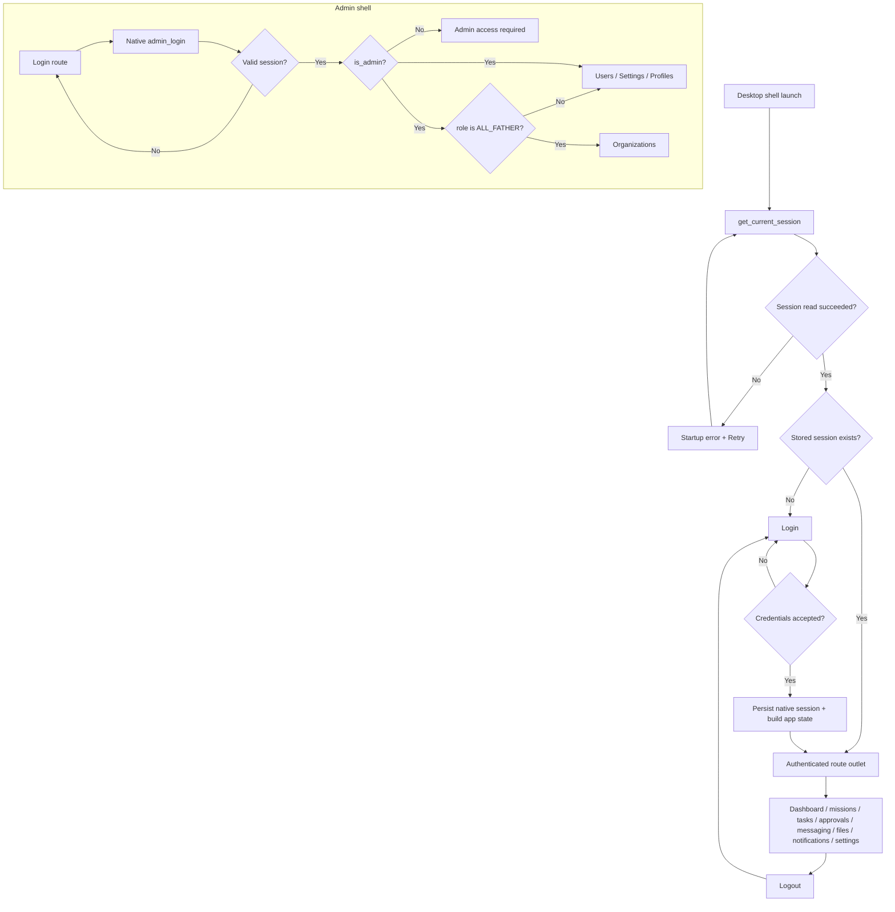

# Navigation and Transition Inventory

Source revision: `d8f64889cfe4473d40d50c41b0992bd22955eb7b`.

## Route and screen table

### APP-DS — desktop shell

| Route/state | Component | Trigger/entry | Guard / result |
|---|---|---|---|
| `/ ` | Dashboard | Default authenticated destination | Reached only when a persisted/authenticated session exists |
| `/missions`, `/missions/:missionId` | Missions | Sidebar; dashboard links; direct route | Shared component handles both collection/detail route patterns |
| `/tasks`, `/tasks/:taskId` | Tasks | Sidebar; dashboard links; direct route | Shared component handles both collection/detail route patterns |
| `/approvals` | Approvals | Sidebar/dashboard navigation | Authenticated route; dialog opens from a selected review action |
| `/messaging`, `/messaging/:conversationId` | Messaging | Sidebar/direct route | Shared component handles list/detail route patterns |
| `/files`, `/files/:fileAssetId` | Files | Sidebar/direct route | Shared component handles list/detail route patterns |
| `/notifications` | Notifications | Sidebar | Authenticated route |
| `/settings` | Settings | Sidebar | Account settings/sign-out |
| unknown path | Navigate to `/` | unmatched route | Redirect; route is still within session-gated route tree |
| conditional login | Login | Fresh install, logout or no saved session | Authentication is performed by Rust command `login` |
| session loading/error | App-level state | startup IPC session lookup | Error state offers Retry |

### APP-AD — Admin shell

| Route/state | Component | Trigger/entry | Guard / result |
|---|---|---|---|
| `/login` | Login | direct route or logout/refresh failure | Credentials sent via native `admin_login`; success navigates to `/` |
| `/`, `/users` | Users | default post-login route/sidebar | Requires authentication and `is_admin` |
| `/settings`, `/settings/:policyId` | Settings | sidebar/deep route | Requires authentication and `is_admin` |
| `/profiles` | Profiles | sidebar | Requires authentication and `is_admin` |
| `/organizations` | Organizations | role-gated sidebar/deep route | Requires authentication, `is_admin`, and role `ALL_FATHER`; otherwise redirects to `/users` |
| unknown path | Navigate to `/` | unmatched route | Redirects to user/default workspace; subsequent auth guards still apply |
| lazy-loading fallback | centered loading text | Suspense while lazy page code resolves | Resolves to lazy-loaded page |
| admin-access-denied state | inline denied panel | authenticated user has no `is_admin` | Log Out control clears stored session |

Route element counts are static JSX declarations, not unique screens. Desktop shell has 13 <Route> elements. Admin shell has 9 <Route> elements: 7 with an explicit path, one index route, and one pathless layout wrapper. Combined total: 22 <Route> elements. The desktop conditional login is rendered outside the route table.

## Verified transition inventory

| Transition ID | Starting state | Event | Result | Handler/evidence |
|---|---|---|---|---|
| NAV-DS-01 | Fresh/open app | React app mounts | `get_current_session` invoked | `desktop-shell/ui/src/App.tsx` |
| NAV-DS-02 | Loading session | Session returned | Login if `null`; route outlet if present | `desktop-shell/ui/src/App.tsx` |
| NAV-DS-03 | Loading session | IPC fails | Startup error alert | `desktop-shell/ui/src/App.tsx` |
| NAV-DS-04 | Startup error | Retry clicked | Session load effect reruns | Retry token in `App.tsx` |
| NAV-DS-05 | Login | Submit credentials | Rust `login`; persist session and rebuild native AppState, then route `/` | `desktop-shell/ui/src/pages/Login.tsx`; `desktop-shell/src/lib.rs:377-420` |
| NAV-DS-06 | Authenticated workspace | Sign out action | Rust `logout`; clears stored session and returns to login state | `desktop-shell/ui/src/components/Layout/MainLayout.tsx`; `desktop-shell/src/lib.rs:422-452` |
| NAV-DS-07 | Wide sidebar | Viewport at or below 960px | Drawer pattern enabled; navigation close/open handling active | `desktop-shell/ui/src/components/Layout/MainLayout.tsx` |
| NAV-DS-08 | Narrow drawer closed | Menu click | Drawer opens; first nav link receives focus | `MainLayout.tsx` |
| NAV-DS-09 | Narrow drawer open | Escape, scrim click, or navigation | Drawer closes; focus restored according to close/navigation handler | `MainLayout.tsx` |
| NAV-DS-10 | Approval item | Review action | Accessible modal overlay opens | `Approvals.tsx`; `ApprovalDialog/index.tsx` |
| NAV-DS-11 | Approval dialog | Approve/Reject | `ApproveTask` / `RejectTask` command with expected version and identity context | `ApprovalDialog/index.tsx:22-41,69-71` |
| NAV-AD-01 | Admin login | Submit | Native `admin_login` -> Worker login endpoint -> validate session -> sessionStorage store -> `/` | `admin-shell/ui/src/pages/Login.tsx`; `admin-shell/src/login.rs` |
| NAV-AD-02 | Protected route | No stored authenticated state | Navigate to `/login` | `admin-shell/ui/src/App.tsx` |
| NAV-AD-03 | Protected route | Authenticated but no admin flag | Admin access required view | `admin-shell/ui/src/App.tsx` |
| NAV-AD-04 | Organization page/navigation | Role is not `ALL_FATHER` | Redirect to `/users`; nav item omitted | `App.tsx`; `components/Layout/adminNavigation.ts` |
| NAV-AD-05 | Any admin request | API responds 401, request is not auth endpoint | Attempt refresh once, retry original request; if refresh fails log out and navigate login | `admin-shell/ui/src/api/client.ts` |
| NAV-AD-06 | Organization detail/card | Manage admins clicked | Select organization and expose admin panel | `admin-shell/ui/src/pages/Organizations.tsx` |
| NAV-AD-07 | Profile list | New/Edit clicked | Profile editor overlay opens | `admin-shell/ui/src/pages/Profiles.tsx` |

## Flow diagram

The diagram shows only transitions directly represented in the inspected source. It does not model implicit operating-system actions or server behavior not traced by source inspection.
