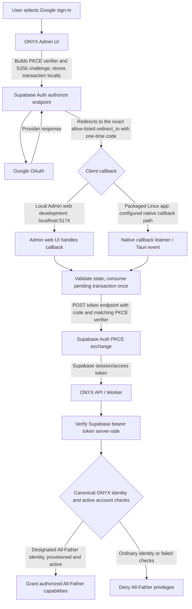

# ONYX Google Authentication Flow

This diagram documents the intended Admin sign-in boundaries. It distinguishes the local Admin web-development origin from the packaged Linux desktop callback. It is an architecture guide, **not evidence that live Google sign-in has passed**.

## Flow overview

## Redirect configuration

| Configuration | Purpose |
|---|---|
| `http://localhost:5174/` | Local Admin development origin. The repository's Admin Tauri config uses port 5174, and the All-Father OAuth helper guards the local web flow to this origin. Keep it in Supabase's allowed redirect URLs only while this development flow is needed. |
| `http://127.0.0.1:17645/auth/callback` | Loopback callback reported by the Linux native OAuth implementation. Keep it only if the packaged Linux build's actual `redirect_to` uses this exact URI. |
| Google OAuth client's authorized redirect URI | Normally Supabase's own Auth callback URL for the project, not the application's final `redirect_to`. Confirm the exact callback shown for the configured Supabase project. |

The redirect passed as `redirect_to` must match an allowed URL in Supabase. Google redirects to Supabase Auth first; Supabase then redirects to the application's allow-listed destination.

## Security boundaries

- The browser/client creates a random PKCE verifier and S256 challenge. The verifier must remain available to the same client origin/transaction until the one-time code exchange.
- Validate the returned state against the pending transaction; reject expired, mismatched, duplicate, or malformed callbacks.
- Exchange the one-time authorization code with the matching verifier. Never log or publish authorization codes, verifiers, access tokens, refresh tokens, or full callback URLs.
- A successful Google/Supabase login is **not** proof of All-Father authority. The ONYX server must verify the Supabase token and resolve the canonical subject against the provisioned, active All-Father identity; client-supplied role metadata must not grant privilege.
- Ordinary authenticated accounts may sign in through the normal path, but must be denied All-Father-only capabilities.

## Verification status

PR #235's recorded runtime smoke test confirmed that the packaged Linux app launched, registered its callback listener, and opened Google's sign-in page. It did **not** complete an authenticated Google session. The full Google → Supabase → callback → PKCE exchange → ONYX session and All-Father-versus-ordinary-account authorization checks remain **NOT VERIFIED** until tested with authorized identities.

Before relying on the packaged-app callback arrow above, verify the actual `redirect_to` generated by the packaged Linux build and the callback URI accepted by its native listener; do not infer this from the local web-development configuration.
