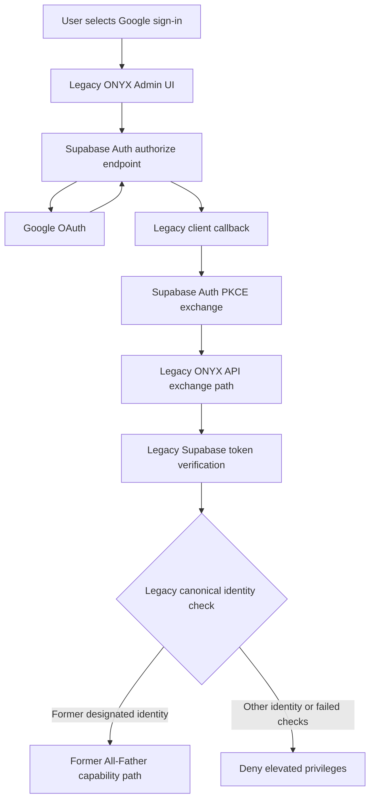

# Historical ONYX Google/Supabase Authentication Flow — Retired

> **Historical reference only. This is not the current sign-in design, setup guide, or verification evidence.** The Google/Supabase All-Father exchange path has been retired from current runtime authentication. Do not restore it based on this document.

This document preserves the previous design and its former verification limits for audit/history purposes. The diagram below describes the retired flow, not the current product.

## Retired flow overview

## Current authentication source of truth

- The supported remote login is ONYX username/password at the Cloudflare Worker route `POST /api/auth/login`.
- The Worker uses D1 as its authority for the canonical All-Father principal, account/organization state, role/admin state, and session revocation.
- All-Father-only routes enforce authority server-side.
- The native Axum login path reserves the `allfather` username and is not an alternate All-Father authentication path.
- There is no supported Google/Supabase fallback for All-Father login. Historical migration records/columns may remain for ledger compatibility and are not current authorization inputs.

For current behavior, use [the authoritative authentication model](../SECURITY_AUTHENTICATION_MODEL.md) and [the Cloudflare Worker documentation](../../deploy/cloudflare/edge-gateway/README.md).

## Historical verification note

Older PR notes and smoke-test records concerning opening Google's sign-in page or registering a native callback do not verify a completed authenticated session, and they do not verify the current ONYX username/password path. Current login claims must be supported by the Worker tests and, for live behavior, a secret-safe test against the deployed Worker after the account is provisioned.
